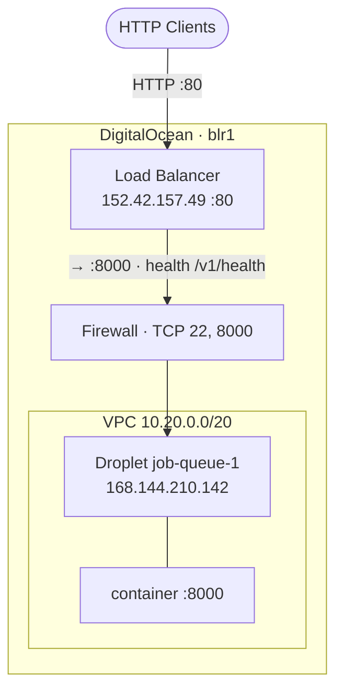
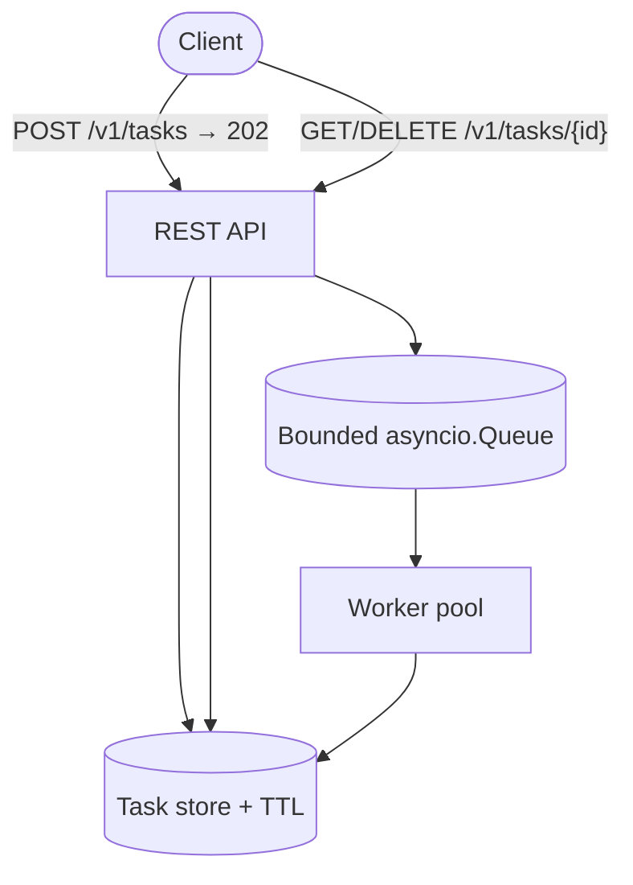
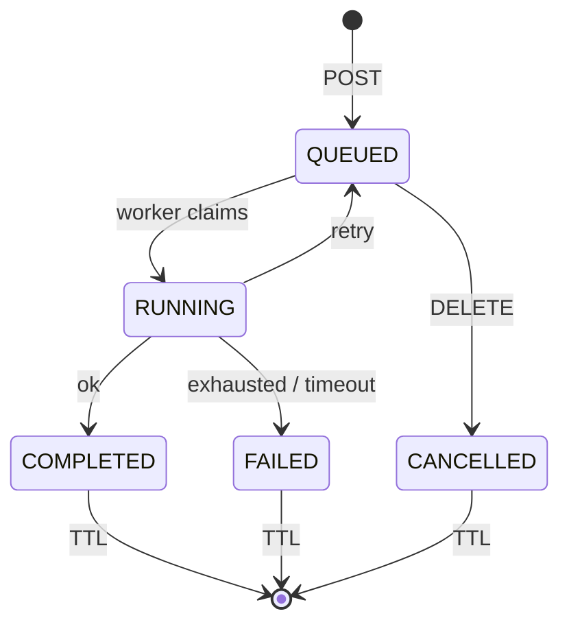

# Demo: In-Memory Job Queue

## Topology

One Droplet, one container (in-memory queue cannot be shared). Public entry is the load balancer.



### What each topology piece is

| Component | What it is |
| :--- | :--- |
| **Clients** | Anything calling the HTTP API (curl, browser, another service). |
| **Load Balancer** | Public front door (`152.42.157.49`). Accepts HTTP on port 80 and forwards to the Droplet on port 8000. Also probes `GET /v1/health` so a dead backend is taken out of rotation. |
| **Firewall** | DigitalOcean cloud firewall on the Droplet. Allows SSH (`22`) and the app port (`8000`); blocks other inbound traffic. |
| **VPC** | Private network (`10.20.0.0/20`) that the Droplet (and LB) sit in. |
| **Droplet** | The VM (`job-queue-1`) running Ubuntu + Docker. Hosts exactly one app container. |
| **Container** | The running job-queue image. All API, queue, workers, and task store live **inside this one process**. |

| | |
| :--- | :--- |
| LB | `http://152.42.157.49` |
| Droplet | `168.144.210.142` |
| Image | `registry.digitalocean.com/shridhar-job-queue/job-queue` |

---

## Application design

Everything below runs **inside** the single container on one asyncio event loop.



### What each application piece is

| Component | What it is |
| :--- | :--- |
| **REST API** | FastAPI endpoints. Accepts work (`POST /v1/tasks`), returns status (`GET`), cancels queued work (`DELETE`), and exposes health (`GET /v1/health`). Submit returns `202` immediately — it does **not** wait for the job to finish. |
| **Bounded asyncio.Queue** | In-memory FIFO buffer between the API and workers. Capacity is fixed (e.g. 10000 in prod). When full, new submits are rejected with `429` (backpressure) instead of growing memory forever. |
| **Task store** | In-memory `dict` of `task_id → Task`, protected by a lock. Holds status, timestamps, result, and error for every known task. This is what `GET /v1/tasks/{id}` reads. It is **not** a database — restart loses it. |
| **TTL cleaner** | Background loop that deletes finished tasks (`COMPLETED` / `FAILED` / `CANCELLED`) after a retention window (default 1 hour) so the store cannot grow without bound. |
| **Worker pool** | Several asyncio coroutines that `await queue.get()`, mark the task `RUNNING`, run the handler (with timeout / retries), then write `COMPLETED` or `FAILED` back to the store. |



### What each status means

| Status | Meaning |
| :--- | :--- |
| **QUEUED** | Accepted and waiting in the queue (or waiting to retry). |
| **RUNNING** | A worker has claimed it and is executing the handler. |
| **COMPLETED** | Finished successfully; `result` is in the task store. |
| **FAILED** | Timed out or retries exhausted; `error` is in the store. |
| **CANCELLED** | Client cancelled it while it was still `QUEUED`. |

---

## Live demo — one case at a time

```bash
export BASE=http://152.42.157.49
# Local fallback:  export BASE=http://localhost:8000
```

Run **one scenario per command**. Each is narrated; short pauses between beats  
(`DEMO_PAUSE=enter` if you want to hit Enter yourself).

---

### Case 1 — Health

**Show:** LB + app are up.

```bash
./ops/scripts/demo-api.sh health
```

**Expect:** `status: HEALTHY`, `queue_capacity`, `total_workers`.

---

### Case 2 — Happy path

**Show:** Submit returns immediately; workers finish later.

```bash
./ops/scripts/demo-api.sh happy
```

**Expect:**
1. `HTTP 202` + `task_id` + `status: QUEUED`
2. Poll: `QUEUED` → `RUNNING` → `COMPLETED` with a `result`

---

### Case 3 — Cancel

**Show:** Only a still-queued task can be cancelled.

```bash
./ops/scripts/demo-api.sh cancel
```

**Expect:** `HTTP 200` + `CANCELLED`, **or** `HTTP 409` if a worker already claimed it (both valid).

---

### Case 4 — Errors

**Show:** Bad requests fail with the right status codes.

```bash
./ops/scripts/demo-api.sh errors
```

**Expect:**
| Call | Code |
| :--- | :--- |
| Unknown task id | `404` |
| Missing `task_type` | `400` |
| Unknown `task_type` | `400` |
| Cancel a finished task | `409` |

---

### Case 5 — Backpressure

**Show:** `202` while the queue has room, then `429` when full.  
Uses a **local** throwaway container (`QUEUE_CAPACITY=3`, `NUM_WORKERS=1`). Needs Docker.

```bash
./ops/scripts/demo-api.sh backpressure
```

**Expect (per-request log):**
1. **Phase A** — `HTTP 202` as the queue fills (`queue=0/3` → `3/3`)
2. **Phase B** — first `HTTP 429 Too Many Requests` ← backpressure
3. **Phase C** (optional) — `202` again only if a worker frees a slot

Also prints the full sequence, e.g. `202 202 202 429 202 429 …`, plus a sample 429 body.

---

## Presenter checklist

| Order | Command | Talking point |
| :---: | :--- | :--- |
| 1 | Topology diagram | LB → firewall → Droplet → one container |
| 2 | Design diagrams | API → queue → workers → store |
| 3 | `… health` | Public path is live |
| 4 | `… happy` | Async job: 202 then COMPLETED |
| 5 | `… cancel` | State machine |
| 6 | `… errors` | 404 / 400 / 409 |
| 7 | `… backpressure` | 202 then 429 — bounded queue |
