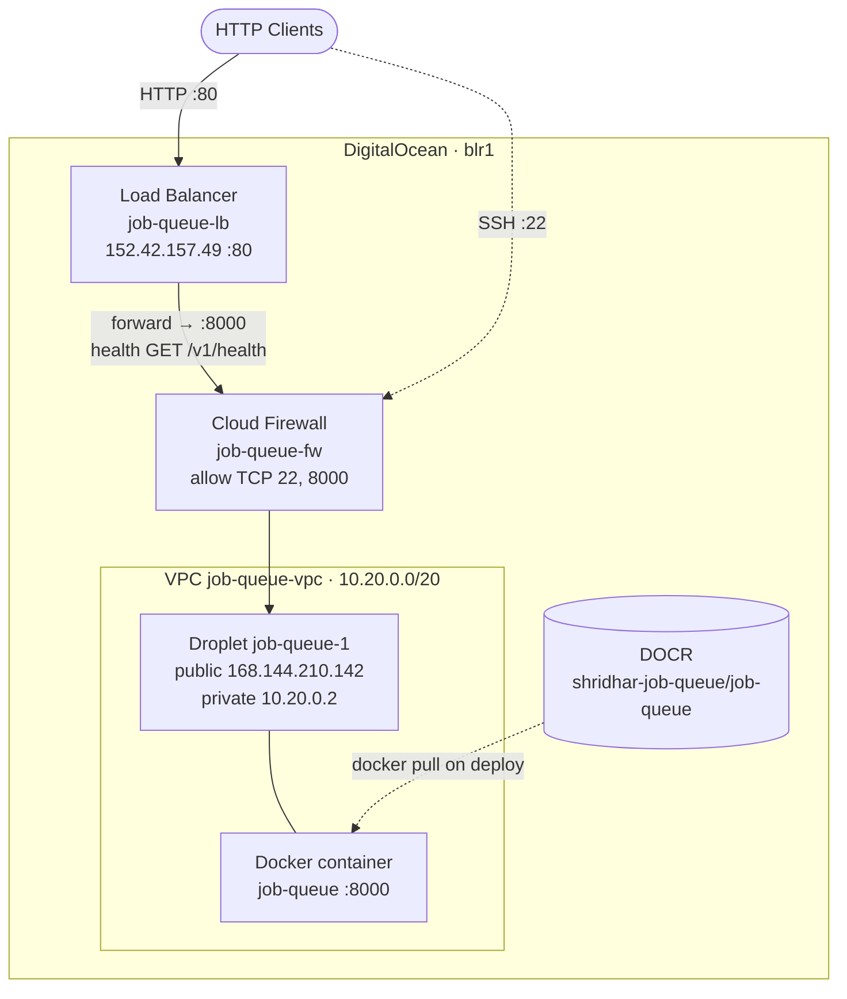
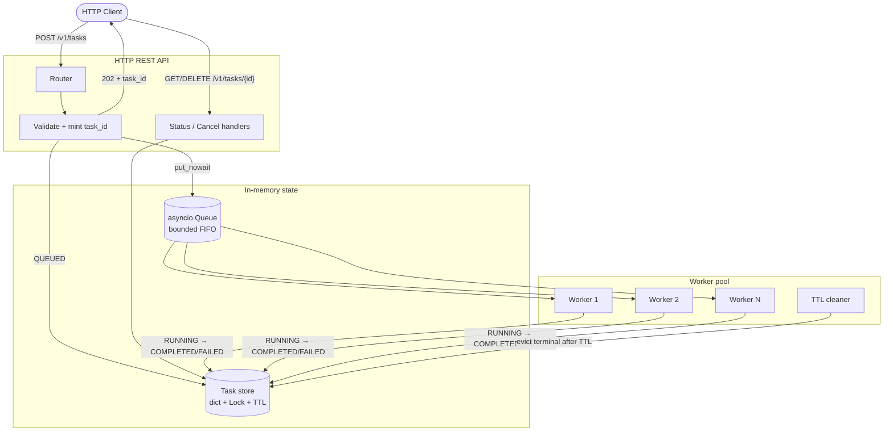
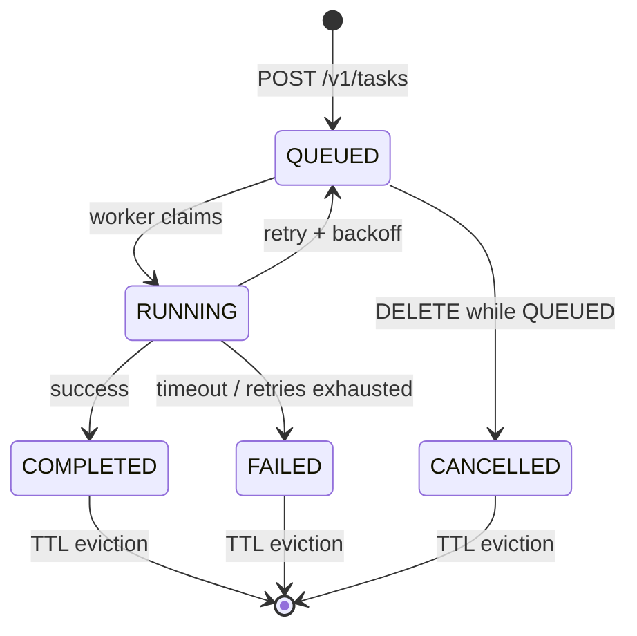

# Demo: In-Memory Job Queue

Live walkthrough of **topology**, **application design**, and **working REST calls**.

| | |
| :--- | :--- |
| Public entry (LB) | `http://152.42.157.49` |
| Droplet (SSH / direct) | `168.144.210.142` |
| App port | `8000` |
| Region | `blr1` |
| Image | `registry.digitalocean.com/shridhar-job-queue/job-queue` |

```bash
export BASE=http://152.42.157.49
# Local:   export BASE=http://localhost:8000
# Direct:  export BASE=http://168.144.210.142:8000

./ops/scripts/demo-api.sh    # full API showcase (no task-id copying)
```

---

## 1. Cloud topology

Infrastructure is Terraform-owned (`ops/iac`). One Droplet runs **one** container — the in-memory queue cannot be shared across replicas.



### Request path

```text
Client
  → LB 152.42.157.49:80
  → Firewall (TCP 8000)
  → Droplet host :8000
  → container job-queue :8000
  → FastAPI (in-process queue + workers)
```

| Resource | Value |
| :--- | :--- |
| VPC | `job-queue-vpc` (`10.20.0.0/20`) |
| Firewall | inbound `22`, `8000` |
| LB → target | HTTP `80` → Droplet `8000` |
| LB health | `GET /v1/health` every 10s |
| Runtime | single Compose service, `restart: unless-stopped` |

**Why one replica:** queue and task store live in process memory. A second instance would not share state; a restart drops in-flight work.

---

## 2. Application design

Everything below runs **inside** the single container on one asyncio event loop.



### Task lifecycle



### API surface

| Method | Path | Success | Typical errors |
| :--- | :--- | :--- | :--- |
| `POST` | `/v1/tasks` | `202` | `400`, `429`, `503` |
| `GET` | `/v1/tasks/{id}` | `200` | `404` |
| `DELETE` | `/v1/tasks/{id}` | `200` | `404`, `409` |
| `GET` | `/v1/health` | `200` | `503` (draining) |

Only registered type today: `DATA_AGGREGATION` (simulated ~200ms handler).

---

## 3. Live demo — prove it works

No copying task IDs. Prefer the script; use the one-liners only if you want to click through by hand.

### Recommended: one script

```bash
export BASE=http://152.42.157.49   # or http://localhost:8000
./ops/scripts/demo-api.sh          # health → happy → cancel → errors → 429
```

Step through while talking:

```bash
./ops/scripts/demo-api.sh health
./ops/scripts/demo-api.sh happy
./ops/scripts/demo-api.sh cancel
./ops/scripts/demo-api.sh errors
./ops/scripts/demo-api.sh backpressure   # needs Docker; uses a tiny local container
```

| Scenario | What you should see |
| :--- | :--- |
| `health` | `status: HEALTHY`, queue/worker metrics |
| `happy` | submit JSON, then auto-poll to `COMPLETED` + `result` |
| `cancel` | `CANCELLED` (or `409` if already running — both valid) |
| `errors` | status lines `404`, `400`, `400`, `409` |
| `backpressure` | counts of `202` + `429`, sample 429 body |

---

### Optional: short manual one-liners

Each command stands alone — no `TASK_ID=` paste.

**Health**

```bash
curl -sS "$BASE/v1/health" | python3 -m json.tool
```

**Submit + wait for result** (captures id for you)

```bash
curl -sS -X POST "$BASE/v1/tasks" \
  -H 'content-type: application/json' \
  -d '{"task_type":"DATA_AGGREGATION","payload":{"dataset_id":"demo-1","operations":["FILTER"],"destination":"s3://out/r.csv"}}' \
| tee /dev/stderr \
| python3 -c "
import sys, json, time, urllib.request, os
base = os.environ['BASE']
tid = json.load(sys.stdin)['task_id']
for _ in range(50):
    t = json.load(urllib.request.urlopen(f'{base}/v1/tasks/{tid}'))
    if t['status'] in ('COMPLETED', 'FAILED', 'CANCELLED'):
        print(json.dumps(t, indent=2)); break
    time.sleep(0.1)
"
```

**Errors in one shot** (only HTTP codes)

```bash
curl -sS -o /dev/null -w "unknown  → %{http_code}\n" "$BASE/v1/tasks/does-not-exist"
curl -sS -o /dev/null -w "bad body → %{http_code}\n" -X POST "$BASE/v1/tasks" \
  -H 'content-type: application/json' -d '{"payload":{}}'
curl -sS -o /dev/null -w "bad type → %{http_code}\n" -X POST "$BASE/v1/tasks" \
  -H 'content-type: application/json' -d '{"task_type":"NOPE","payload":{}}'
```

**Backpressure** — use the script (it spins a capacity=5 container, bursts 40 submits, prints counts, cleans up):

```bash
./ops/scripts/demo-api.sh backpressure
```

---

## 4. Demo checklist (talking points)

| Step | Show | What it proves |
| :--- | :--- | :--- |
| Topology diagram | LB → FW → Droplet → container | Public path and single-replica constraint |
| App diagram | API → queue → workers → store | Async submit, in-memory design |
| `demo-api.sh health` | `HEALTHY` via LB | Infra + app wired |
| `demo-api.sh happy` | `COMPLETED` + result | End-to-end path |
| `demo-api.sh cancel` | `CANCELLED` / `409` | State machine |
| `demo-api.sh errors` | `404` / `400` / `409` | Error contracts |
| `demo-api.sh backpressure` | `429` counts | Bounded queue |
| Optional: `docker stop` / redeploy | Drain within grace | Graceful shutdown |

---

## 5. Quick local full stack (optional)

```bash
docker compose up --build -d
export BASE=http://localhost:8000
./ops/scripts/demo-api.sh
docker compose down
```
