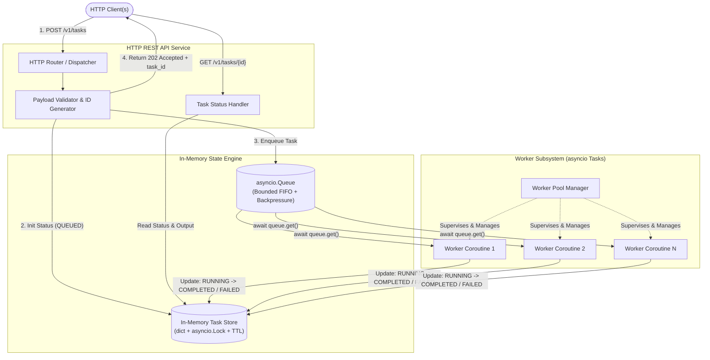
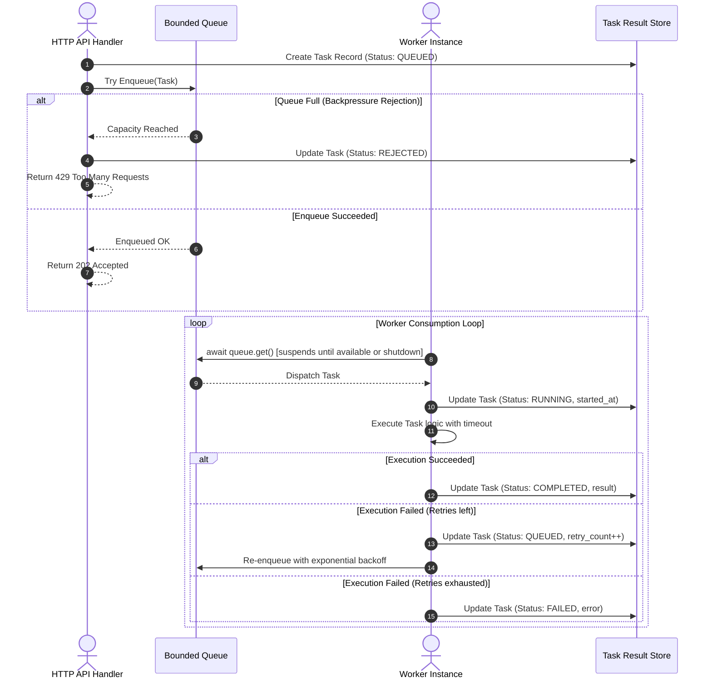
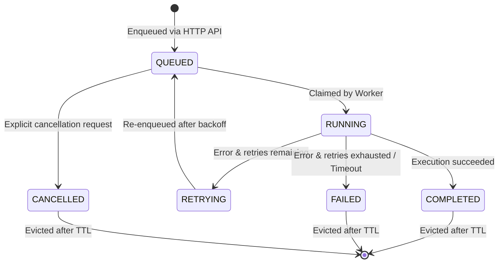

# System Design: In-Memory Asynchronous Job Processing Service

## 1. Overview & Requirements

### Language & Runtime
- **Language**: Python 3.11+
- **HTTP framework**: FastAPI (ASGI) + Uvicorn
- **Concurrency model**: `asyncio` event loop with a pool of concurrent worker coroutines
- **Queue**: bounded `asyncio.Queue` (FIFO, capacity-enforced backpressure)
- **CPU-bound offload** (optional): `asyncio.to_thread` / `ProcessPoolExecutor` so heavy work does not block the event loop
- **Why this stack**: preserves non-blocking submission, concurrent multi-worker consumption, backpressure, isolation, and graceful shutdown—idiomatically in Python without requiring Go-style OS threads/goroutines

### Functional Requirements
- **HTTP REST API Service**: Expose endpoints for clients to submit work payloads asynchronously and retrieve task statuses and results.
- **In-Memory Message Queue**: Buffer submitted work items in memory with asyncio-safe FIFO semantics and bounded capacity.
- **Concurrent Multi-Worker Consumer Pool**: Support multiple worker coroutines concurrently popping and processing tasks from the queue without duplicate execution or race conditions.
- **Task Status & Result Querying**: Allow clients to inspect job progression (`QUEUED`, `RUNNING`, `COMPLETED`, `FAILED`, `CANCELLED`) and view execution outputs or error messages.

### Non-Functional Requirements
- **Low Latency Submission**: Work submission must return immediately with `202 Accepted` after enqueueing, decoupling client ingestion from execution latency.
- **Concurrency Safety**: Shared queue structures, counters, and task status mappings must be safe under concurrent coroutine access (and under thread/process offload where used).
- **Backpressure & Resource Bounding**: The in-memory queue must enforce an explicit capacity limit. When full, the API must fail fast and reject submissions with HTTP `429 Too Many Requests` or `503 Service Unavailable`.
- **Fault Tolerance & Exception Isolation**: Unhandled exceptions in individual workers must be isolated so they do not crash the service or worker pool.
- **Graceful Shutdown**: On `SIGINT`/`SIGTERM`, stop accepting new HTTP requests, drain remaining queued work within a grace period, and cleanly cancel/await workers.
- **Memory Hygiene**: Evict finished tasks from memory using a TTL (Time-To-Live) cache or periodic reaper to prevent unbounded memory growth.

---

## 2. High-Level Architecture



---

## 3. API Specification

### Endpoints Summary

| Method | Path | Description | Success Status | Error Status |
| :--- | :--- | :--- | :--- | :--- |
| `POST` | `/v1/tasks` | Submit new work to the queue | `202 Accepted` | `400 Bad Request`, `429 Too Many Requests` |
| `GET` | `/v1/tasks/{id}` | Query execution status & results | `200 OK` | `404 Not Found` |
| `DELETE` | `/v1/tasks/{id}` | Cancel pending task | `200 OK` / `204 No Content` | `404 Not Found`, `409 Conflict` |
| `GET` | `/v1/health` | System health & queue metrics | `200 OK` | `503 Service Unavailable` |

---

### Request & Response Schemas

#### 1. Submit Work
- **Endpoint**: `POST /v1/tasks`
- **Request Body**:
```json
{
  "task_type": "DATA_AGGREGATION",
  "priority": 1,
  "payload": {
    "dataset_id": "ds-9982",
    "operations": ["FILTER", "SUMMARIZE"],
    "destination": "s3://output-bucket/report.csv"
  },
  "max_retries": 3,
  "timeout_seconds": 30
}
```

- **Response** (`202 Accepted`):
```json
{
  "task_id": "c7a8b19e-5b12-4f81-b543-99d81d2f89c0",
  "status": "QUEUED",
  "submitted_at": "2026-11-20T14:35:00Z",
  "poll_url": "/v1/tasks/c7a8b19e-5b12-4f81-b543-99d81d2f89c0"
}
```

- **Backpressure Response** (`429 Too Many Requests`):
```json
{
  "error": "QUEUE_CAPACITY_EXCEEDED",
  "message": "In-memory queue is currently at capacity. Please retry shortly.",
  "retry_after_seconds": 3
}
```

#### 2. Query Task Status
- **Endpoint**: `GET /v1/tasks/{id}`
- **Response** (`200 OK` - Completed):
```json
{
  "task_id": "c7a8b19e-5b12-4f81-b543-99d81d2f89c0",
  "status": "COMPLETED",
  "task_type": "DATA_AGGREGATION",
  "submitted_at": "2026-11-20T14:35:00Z",
  "started_at": "2026-11-20T14:35:01Z",
  "completed_at": "2026-11-20T14:35:03Z",
  "duration_ms": 2150,
  "retry_count": 0,
  "result": {
    "rows_processed": 142050,
    "summary_url": "s3://output-bucket/report.csv"
  },
  "error": null
}
```

---

## 4. In-Memory Queue Architecture



### Core Design Rules
1. **Bounded Buffer**: Queue capacity is strictly fixed (e.g., 5,000–50,000 items) via `asyncio.Queue(maxsize=N)` to prevent memory exhaustion (OOM).
2. **Async Synchronization**:
   - **`asyncio.Queue`**: Workers `await queue.get()` when empty (suspend without blocking the event loop). Producers use `queue.put_nowait()` and catch `asyncio.QueueFull` so HTTP handlers fail fast instead of waiting.
   - **Shared state**: Protect the task-store `dict` with an `asyncio.Lock` (or confine mutations to the event-loop thread only). Offloaded CPU work must not mutate shared structures without synchronization.
   - **Optional scale-up**: For CPU-heavy payloads, run work in `asyncio.to_thread` / `ProcessPoolExecutor` while keeping enqueue/dequeue on the event loop.
3. **Ordering Guarantee**: Strict FIFO within the same priority level.

---

## 5. Concurrent Multi-Worker Consumer Pool

### Task Lifecycle State Machine



### Worker Pool Policies
1. **Worker Sizing Formulation**:
   - **I/O-Intensive Tasks** (HTTP calls, DB, storage — default for this service):
     $$N_{\text{workers}} = N_{\text{CPU}} \times \left(1 + \frac{\text{Wait Time}}{\text{Compute Time}}\right)$$
     Typical values: 10 to 64 concurrent `asyncio` worker tasks on one event loop.
   - **CPU-Intensive Tasks**: keep a smaller asyncio worker count and offload to a process/thread pool sized near $N_{\text{CPU}}$ (GIL / process boundaries apply).
2. **Exception Isolation**:
   - Every worker wraps task execution in `try` / `except Exception`.
   - If an unhandled exception occurs, the offending task is marked `FAILED` with error diagnostics, and the worker loop continues seamlessly.
3. **Per-Task Timeouts**:
   - Workers run each task under `asyncio.wait_for(..., timeout=timeout_seconds)` (or an `asyncio.timeout` context). On timeout, the task transitions to `FAILED (TIMEOUT)`.
4. **Retry with Exponential Backoff & Jitter**:
   - Backoff interval: $T_{\text{wait}} = \min(T_{\text{max}}, T_{\text{base}} \times 2^{\text{retry}} + \text{jitter})$.
   - Implemented with `await asyncio.sleep(backoff)` before re-enqueue.

---

## 6. Memory Hygiene & State Management

Because the queue and state store reside in-memory:
1. **Task Metadata Store**:
   - In-process `dict[str, Task]` guarded by `asyncio.Lock` (single-writer semantics on the event loop).
2. **TTL Eviction Sweeper**:
   - Terminal states (`COMPLETED`, `FAILED`, `CANCELLED`) are tagged with `completed_at`.
   - A background `asyncio` task ticks every 60 seconds and purges entries older than `RETENTION_TTL` (e.g., 1 hour).
   - Prevents memory leaks under sustained 24/7 load.

---

## 7. Graceful Shutdown Sequence

```mermaid
sequenceDiagram
    autonumber
    participant OS as OS Signal (SIGTERM/SIGINT)
    participant Server as HTTP Server (Uvicorn/FastAPI)
    participant Q as asyncio.Queue
    participant Pool as Worker Pool
    participant Store as Task Store

    OS->>Server: Send SIGTERM
    Server->>Server: Stop accepting new requests (HTTP 503 / close listener)
    Server->>Pool: Set shutdown Event / cancel worker tasks
    Server->>Q: Stop enqueue; allow workers to drain
    loop Drain Period (Timeout: 30s)
        Pool->>Q: await remaining tasks (queue.join / get)
        Pool->>Store: Save final states
    end
    Pool-->>Server: All worker tasks completed or cancelled
    Server->>OS: Process exits cleanly (code 0)
```

---

## 8. Idiomatic Implementation Blueprint (Python / asyncio)

```python
from __future__ import annotations

import asyncio
from dataclasses import dataclass, field
from datetime import datetime, timezone
from enum import Enum
from typing import Any


class TaskStatus(str, Enum):
    QUEUED = "QUEUED"
    RUNNING = "RUNNING"
    COMPLETED = "COMPLETED"
    FAILED = "FAILED"
    CANCELLED = "CANCELLED"


@dataclass
class Task:
    id: str
    payload: Any
    status: TaskStatus = TaskStatus.QUEUED
    result: Any | None = None
    error: str | None = None
    submitted_at: datetime = field(default_factory=lambda: datetime.now(timezone.utc))
    started_at: datetime | None = None
    completed_at: datetime | None = None


class QueueFullError(Exception):
    pass


class TaskService:
    """In-memory async job queue with concurrent worker coroutines."""

    def __init__(self, capacity: int, num_workers: int) -> None:
        self.queue: asyncio.Queue[Task] = asyncio.Queue(maxsize=capacity)
        self.task_store: dict[str, Task] = {}
        self._store_lock = asyncio.Lock()
        self._workers: list[asyncio.Task[None]] = []
        self._cleaner: asyncio.Task[None] | None = None
        self._shutdown = asyncio.Event()
        self._num_workers = num_workers

    async def start(self) -> None:
        for i in range(self._num_workers):
            self._workers.append(asyncio.create_task(self._worker(i), name=f"worker-{i}"))
        self._cleaner = asyncio.create_task(
            self._start_cleaner(ttl_seconds=3600, interval_seconds=60),
            name="ttl-cleaner",
        )

    async def enqueue(self, task: Task) -> None:
        """Non-blocking enqueue with backpressure (fail-fast when full)."""
        task.status = TaskStatus.QUEUED
        task.submitted_at = datetime.now(timezone.utc)
        async with self._store_lock:
            self.task_store[task.id] = task

        try:
            self.queue.put_nowait(task)
        except asyncio.QueueFull:
            async with self._store_lock:
                task.status = TaskStatus.FAILED
                task.error = "queue capacity exceeded"
                task.completed_at = datetime.now(timezone.utc)
            raise QueueFullError("queue full") from None

    async def get_task(self, task_id: str) -> Task | None:
        async with self._store_lock:
            return self.task_store.get(task_id)

    async def _worker(self, worker_id: int) -> None:
        while not self._shutdown.is_set():
            try:
                task = await asyncio.wait_for(self.queue.get(), timeout=0.5)
            except asyncio.TimeoutError:
                continue
            try:
                await self._execute(task)
            finally:
                self.queue.task_done()

    async def _execute(self, task: Task) -> None:
        async with self._store_lock:
            task.status = TaskStatus.RUNNING
            task.started_at = datetime.now(timezone.utc)

        try:
            # Optional: await asyncio.to_thread(...) for CPU-bound payloads
            await asyncio.wait_for(self._run_unit_of_work(task), timeout=30)
            async with self._store_lock:
                task.status = TaskStatus.COMPLETED
                task.result = {"status": "ok"}
                task.completed_at = datetime.now(timezone.utc)
        except asyncio.TimeoutError:
            async with self._store_lock:
                task.status = TaskStatus.FAILED
                task.error = "TIMEOUT"
                task.completed_at = datetime.now(timezone.utc)
        except Exception as exc:  # isolate worker failures
            async with self._store_lock:
                task.status = TaskStatus.FAILED
                task.error = f"exception: {exc}"
                task.completed_at = datetime.now(timezone.utc)

    async def _run_unit_of_work(self, task: Task) -> None:
        await asyncio.sleep(0.2)  # simulated async work

    async def _start_cleaner(self, ttl_seconds: float, interval_seconds: float) -> None:
        while not self._shutdown.is_set():
            try:
                await asyncio.wait_for(self._shutdown.wait(), timeout=interval_seconds)
                break
            except asyncio.TimeoutError:
                pass
            now = datetime.now(timezone.utc)
            async with self._store_lock:
                expired = [
                    key
                    for key, t in self.task_store.items()
                    if t.status in (TaskStatus.COMPLETED, TaskStatus.FAILED, TaskStatus.CANCELLED)
                    and t.completed_at is not None
                    and (now - t.completed_at).total_seconds() > ttl_seconds
                ]
                for key in expired:
                    del self.task_store[key]

    async def shutdown(self, drain_timeout: float = 30.0) -> None:
        self._shutdown.set()
        try:
            await asyncio.wait_for(self.queue.join(), timeout=drain_timeout)
        except asyncio.TimeoutError:
            pass
        for worker in self._workers:
            worker.cancel()
        if self._cleaner:
            self._cleaner.cancel()
        await asyncio.gather(*self._workers, self._cleaner, return_exceptions=True)
```

---

## 9. Observability & Telemetry

- **`GET /v1/health`**:
  ```json
  {
    "status": "HEALTHY",
    "queue_depth": 142,
    "queue_capacity": 10000,
    "active_workers": 8,
    "total_workers": 16,
    "uptime_seconds": 18450
  }
  ```
- **Prometheus Metrics**:
  - `queue_depth_current` (Gauge)
  - `tasks_enqueued_total` (Counter by type)
  - `tasks_processed_total` (Counter by type and status: `completed`, `failed`)
  - `task_execution_duration_seconds` (Histogram)
  - `worker_utilization_ratio` (Gauge)
