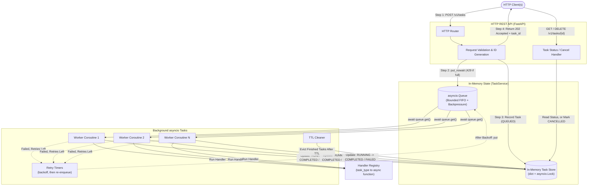
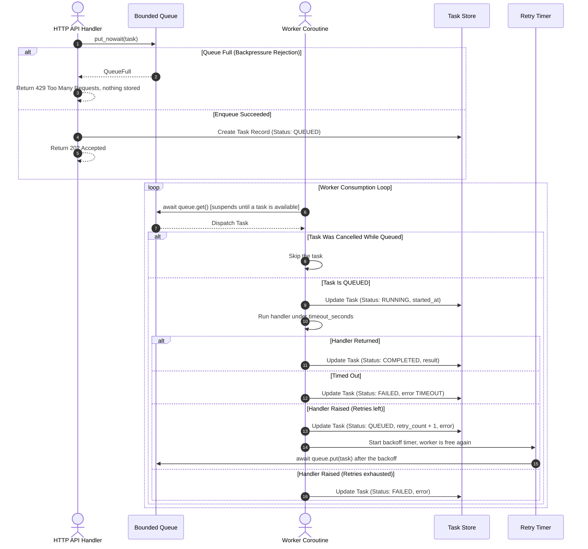
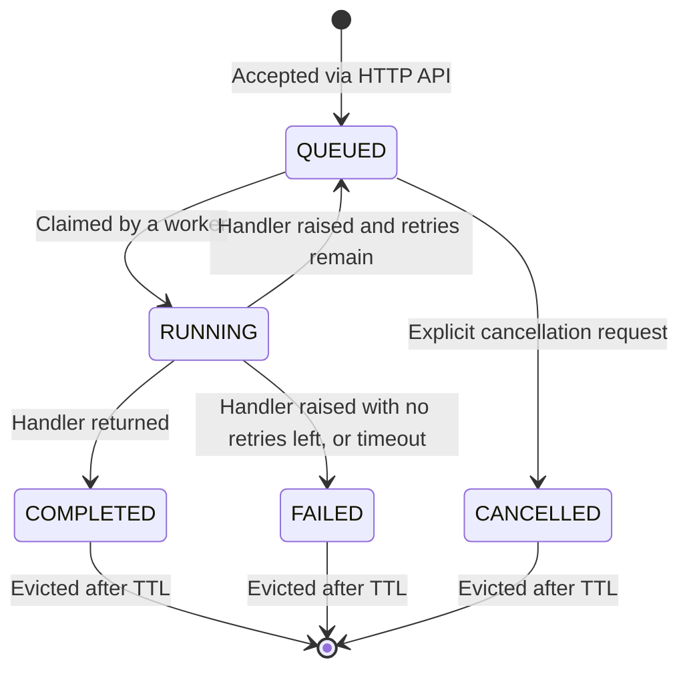
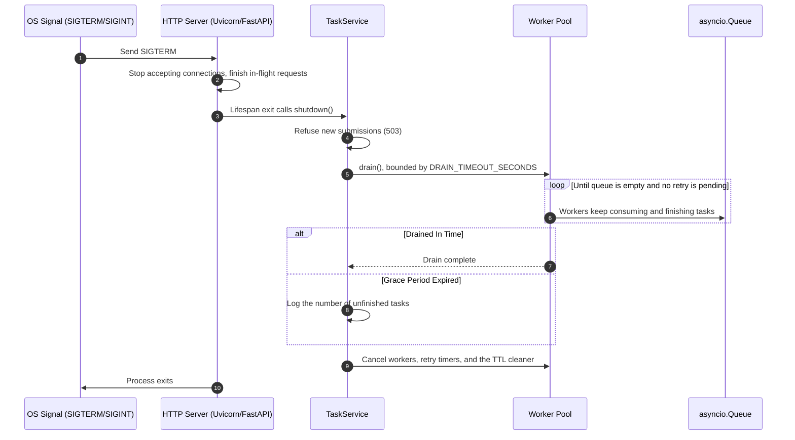

# System Design: In-Memory Asynchronous Job Processing Service

This document describes the service as implemented in `src/job_queue/`.

## 1. Overview & Requirements

### Language & Runtime
- **Language**: Python 3.11+
- **HTTP framework**: FastAPI (ASGI) + Uvicorn
- **Concurrency model**: one process, one `asyncio` event loop, a fixed pool of worker coroutines
- **Queue**: bounded `asyncio.Queue` (FIFO, capacity-enforced backpressure)
- **Configuration**: environment variables, validated at startup with `pydantic-settings` (Section 10)
- **Packaging**: one container image; the API, queue, task store, and workers all run inside it
- **Why this stack**: non-blocking submission, concurrent multi-worker consumption, backpressure, failure isolation, and graceful shutdown, without threads or an external broker

**Implementation**
- Entry point: [`main.py`](../src/job_queue/main.py)
- App factory and lifespan: [`create_app`](../src/job_queue/api/app.py)
- Settings: [`Settings`](../src/job_queue/config.py)
- Dependencies: [`pyproject.toml`](../pyproject.toml)
- Container image: [`Dockerfile`](../Dockerfile)
- Package overview: [`src/job_queue/README.md`](../src/job_queue/README.md)

### Functional Requirements
- **HTTP REST API Service**: Endpoints for clients to submit work asynchronously, query task status and results, cancel queued tasks, and check service health.
- **In-Memory Message Queue**: Submitted work is buffered in memory in a bounded FIFO queue.
- **Concurrent Multi-Worker Consumer Pool**: Multiple worker coroutines consume the same queue at the same time. Each task is delivered to exactly one worker.
- **Task Status & Result Querying**: Clients can follow a task through `QUEUED`, `RUNNING`, `COMPLETED`, `FAILED`, and `CANCELLED`, and read its result or error.

### Non-Functional Requirements
- **Low Latency Submission**: Submission returns `202 Accepted` as soon as the task is on the queue. It never waits for execution.
- **Concurrency Safety**: Every task status change (submit, claim, finish, cancel, evict) happens under one `asyncio.Lock`, on the single event loop.
- **Backpressure & Resource Bounding**: The queue has a fixed capacity. When it is full, submission fails fast with `429 Too Many Requests`. During shutdown, submission is refused with `503 Service Unavailable`.
- **Fault Tolerance & Exception Isolation**: An exception in a task handler fails or retries only that task. The worker and the service keep running.
- **Graceful Shutdown**: On `SIGINT`/`SIGTERM` the service stops taking requests, drains queued and running work within a grace period, then stops its workers.
- **Memory Hygiene**: A periodic cleaner evicts finished tasks from memory after a retention TTL.

**Implementation**

| Requirement | Code |
| :--- | :--- |
| Low latency submission | [`TaskService.submit`](../src/job_queue/services/task_service.py) |
| Concurrency safety | The lock in [`TaskService`](../src/job_queue/services/task_service.py), shared with [`WorkerPool`](../src/job_queue/services/worker_pool.py) and [`Cleaner`](../src/job_queue/services/cleaner.py) |
| Backpressure | [`TaskService.submit`](../src/job_queue/services/task_service.py), mapped to `429` in [`api/errors.py`](../src/job_queue/api/errors.py) |
| Exception isolation | [`WorkerPool._execute`](../src/job_queue/services/worker_pool.py) |
| Graceful shutdown | [`TaskService.shutdown`](../src/job_queue/services/task_service.py), [`WorkerPool.drain`](../src/job_queue/services/worker_pool.py) |
| Memory hygiene | [`Cleaner`](../src/job_queue/services/cleaner.py) |

### Scope limits
- **State is in memory only.** A restart, redeploy, or crash drops the queue and every task record.
- **One instance only.** A second replica would have its own queue and store, so the service cannot be scaled out horizontally.

---

## 2. High-Level Architecture



**Implementation**

| Diagram element | Code |
| :--- | :--- |
| HTTP Router | [`api/routes/tasks.py`](../src/job_queue/api/routes/tasks.py), [`api/routes/health.py`](../src/job_queue/api/routes/health.py), wired up in [`api/app.py`](../src/job_queue/api/app.py) |
| Request Validation & ID Generation | [`SubmitTaskRequest`](../src/job_queue/schemas/tasks.py); the id is generated in [`TaskService.submit`](../src/job_queue/services/task_service.py) |
| Task Status / Cancel Handler | [`get_task`, `cancel_task`](../src/job_queue/api/routes/tasks.py) |
| `asyncio.Queue` and Task Store | [`TaskService`](../src/job_queue/services/task_service.py) |
| Worker Coroutines and Retry Timers | [`WorkerPool`](../src/job_queue/services/worker_pool.py) |
| TTL Cleaner | [`Cleaner`](../src/job_queue/services/cleaner.py) |
| Handler Registry | [`HandlerRegistry`](../src/job_queue/services/handlers.py) |

---

## 3. API Specification

### Endpoints Summary

| Method | Path | Description | Success Status | Error Status |
| :--- | :--- | :--- | :--- | :--- |
| `POST` | `/v1/tasks` | Submit new work to the queue | `202 Accepted` | `400 Bad Request`, `429 Too Many Requests`, `503 Service Unavailable` |
| `GET` | `/v1/tasks/{id}` | Query execution status & results | `200 OK` | `404 Not Found` |
| `DELETE` | `/v1/tasks/{id}` | Cancel a task that is still `QUEUED` | `200 OK` | `404 Not Found`, `409 Conflict` |
| `GET` | `/v1/health` | System health & queue metrics | `200 OK` | `503 Service Unavailable` |

**Implementation**
- Task endpoints: [`api/routes/tasks.py`](../src/job_queue/api/routes/tasks.py)
- Health endpoint: [`api/routes/health.py`](../src/job_queue/api/routes/health.py)
- Request and response models: [`schemas/tasks.py`](../src/job_queue/schemas/tasks.py), [`schemas/health.py`](../src/job_queue/schemas/health.py)
- Access to the running service from a route: [`api/deps.py`](../src/job_queue/api/deps.py)

---

### Request & Response Schemas

#### 1. Submit Work
- **Endpoint**: `POST /v1/tasks`
- **Implementation**: route [`submit_task`](../src/job_queue/api/routes/tasks.py), models [`SubmitTaskRequest`, `SubmitTaskResponse`](../src/job_queue/schemas/tasks.py), logic [`TaskService.submit`](../src/job_queue/services/task_service.py), simulated handler [`data_aggregation`](../src/job_queue/services/handlers.py)
- **Request Body**:
```json
{
  "task_type": "DATA_AGGREGATION",
  "priority": 1,
  "payload": {
    "dataset_id": "ds-9982",
    "operations": ["FILTER", "SUMMARIZE"],
    "destination": "s3://output-bucket/report.csv"
  },
  "max_retries": 3,
  "timeout_seconds": 30
}
```

- **Request Fields**:

| Field | Rule | Default |
| :--- | :--- | :--- |
| `task_type` | Required, 1 to 64 characters, must have a registered handler | none |
| `priority` | Integer, 0 or more. Stored and returned, but does not affect ordering | `0` |
| `payload` | JSON object, passed to the handler | `{}` |
| `max_retries` | 0 to 10 | `0` |
| `timeout_seconds` | Greater than 0, at most 3600 | `30` |

`DATA_AGGREGATION` is the only registered task type. Its handler is a simulation that waits 200 ms and echoes parts of the payload.

- **Response** (`202 Accepted`):
```json
{
  "task_id": "a328d053-81d5-4942-a97c-02db4176b6bc",
  "status": "QUEUED",
  "submitted_at": "2026-11-20T09:58:16.533583Z",
  "poll_url": "/v1/tasks/a328d053-81d5-4942-a97c-02db4176b6bc"
}
```

- **Backpressure Response** (`429 Too Many Requests`, with a `Retry-After: 3` header):
```json
{
  "error": "QUEUE_CAPACITY_EXCEEDED",
  "message": "In-memory queue is currently at capacity. Please retry shortly.",
  "retry_after_seconds": 3
}
```

A rejected submission gets no `task_id` and leaves no record in the task store.

#### 2. Query Task Status
- **Endpoint**: `GET /v1/tasks/{id}`
- **Implementation**: route [`get_task`](../src/job_queue/api/routes/tasks.py), model [`TaskStatusResponse`](../src/job_queue/schemas/tasks.py), logic [`TaskService.get`](../src/job_queue/services/task_service.py), record [`Task`](../src/job_queue/domain/task.py)
- **Response** (`200 OK` - Completed):
```json
{
  "task_id": "a328d053-81d5-4942-a97c-02db4176b6bc",
  "status": "COMPLETED",
  "task_type": "DATA_AGGREGATION",
  "priority": 1,
  "submitted_at": "2026-11-20T09:58:16.533583Z",
  "started_at": "2026-11-20T09:58:16.533862Z",
  "completed_at": "2026-11-20T09:58:16.735528Z",
  "duration_ms": 202,
  "retry_count": 0,
  "result": {
    "dataset_id": "ds-9982",
    "operations_applied": ["FILTER", "SUMMARIZE"],
    "summary_url": "s3://output-bucket/report.csv"
  },
  "error": null
}
```

- `started_at` is the start of the most recent attempt, so `duration_ms` covers the attempt that produced the final outcome and excludes retry backoff.
- For a `FAILED` task, `result` is `null` and `error` holds `TIMEOUT` or `<ExceptionType>: <message>`.

#### 3. Cancel Task
- **Endpoint**: `DELETE /v1/tasks/{id}`
- **Implementation**: route [`cancel_task`](../src/job_queue/api/routes/tasks.py), logic [`TaskService.cancel`](../src/job_queue/services/task_service.py)
- **Response** (`200 OK`): the same shape as the status response, with `"status": "CANCELLED"` and `completed_at` set.
- Only a `QUEUED` task can be cancelled. A `RUNNING`, `COMPLETED`, `FAILED`, or already `CANCELLED` task returns `409 Conflict`.

#### 4. Error Responses

Every error body has the shape `{"error": "<CODE>", "message": "<text>"}`.

**Implementation**: exceptions in [`domain/errors.py`](../src/job_queue/domain/errors.py), mapped to responses by [`register_error_handlers`](../src/job_queue/api/errors.py)

| Status | `error` code | When |
| :--- | :--- | :--- |
| `400` | `INVALID_REQUEST` | The body is not valid JSON or breaks a field rule. Adds a `details` list of `{field, message}` |
| `400` | `UNKNOWN_TASK_TYPE` | No handler is registered for `task_type` |
| `404` | `TASK_NOT_FOUND` | The id is unknown, or the task was evicted after its TTL |
| `409` | `TASK_NOT_CANCELLABLE` | Cancel was requested for a task that is not `QUEUED` |
| `429` | `QUEUE_CAPACITY_EXCEEDED` | The queue is full. Adds `retry_after_seconds` and a `Retry-After` header |
| `503` | `SERVICE_UNAVAILABLE` | The service is shutting down |

---

## 4. In-Memory Queue Architecture

**Implementation**
- Enqueue with backpressure: [`TaskService.submit`](../src/job_queue/services/task_service.py)
- Worker loop and claim: [`WorkerPool._worker`, `WorkerPool._process`](../src/job_queue/services/worker_pool.py)
- Execution outcome: [`WorkerPool._execute`, `WorkerPool._fail`](../src/job_queue/services/worker_pool.py)
- Retry timer and re-enqueue: [`WorkerPool._fail_or_retry`, `WorkerPool._requeue_after`](../src/job_queue/services/worker_pool.py)



### Core Design Rules
1. **Bounded Buffer**: Queue capacity is fixed at startup by `QUEUE_CAPACITY` (default 10,000) via `asyncio.Queue(maxsize=N)`. Code: [`TaskService.__init__`](../src/job_queue/services/task_service.py).
2. **Async Synchronization**:
   - **`asyncio.Queue`**: Workers `await queue.get()` when the queue is empty, which suspends them without blocking the event loop. The submit path uses `queue.put_nowait()` and turns `asyncio.QueueFull` into a `429`, so HTTP handlers fail fast and never wait for space.
   - **Shared state**: The task store is a `dict` guarded by one `asyncio.Lock`. Enqueue and record-creation happen inside the same critical section, so a worker can never see a queued task that has no record.
   - Code: [`TaskService.submit`](../src/job_queue/services/task_service.py), [`WorkerPool._worker`](../src/job_queue/services/worker_pool.py).
3. **Ordering Guarantee**: Strict FIFO. The `priority` field is stored but not used for ordering. A retried task rejoins at the tail of the queue. Code: [`Task.priority`](../src/job_queue/domain/task.py).
4. **One Queue for Everything**: New submissions and retries share the same queue. There is no separate retry queue and no dead-letter queue.
5. **Retries Are Never Rejected**: A task waiting out its backoff is held by a timer, outside the queue's capacity. When the backoff ends it uses `await queue.put()`, which waits for a free slot instead of failing. Code: [`WorkerPool._requeue_after`](../src/job_queue/services/worker_pool.py).

---

## 5. Concurrent Multi-Worker Consumer Pool

### Task Lifecycle State Machine



There is no separate `RETRYING` state. A task waiting for its retry is `QUEUED` with a `retry_count` above zero and the last error recorded.

**Implementation**
- States: [`TaskStatus`](../src/job_queue/domain/status.py)
- Task record: [`Task`](../src/job_queue/domain/task.py)
- `QUEUED` to `RUNNING`, `COMPLETED`, `FAILED`, and back to `QUEUED`: [`WorkerPool`](../src/job_queue/services/worker_pool.py)
- `QUEUED` to `CANCELLED`: [`TaskService.cancel`](../src/job_queue/services/task_service.py)
- Eviction after TTL: [`Cleaner.sweep`](../src/job_queue/services/cleaner.py)

### Worker Pool Policies
1. **Worker Sizing**:
   - The pool is a fixed number of worker coroutines, set by `NUM_WORKERS` (default 16). It does not grow or shrink at runtime.
   - Guidance for I/O-bound handlers (HTTP calls, DB, storage):
     $$N_{\text{workers}} = N_{\text{CPU}} \times \left(1 + \frac{\text{Wait Time}}{\text{Compute Time}}\right)$$
   - CPU-bound offload is not implemented. Handlers are async functions that run on the event loop, so a handler that computes for a long time without awaiting blocks every worker and the API.
   - Code: [`WorkerPool.start`](../src/job_queue/services/worker_pool.py), [`Settings.num_workers`](../src/job_queue/config.py).
2. **Exactly-Once Dispatch**:
   - `asyncio.Queue` hands each queued item to exactly one waiting worker.
   - The worker then claims the task under the store lock by changing `QUEUED` to `RUNNING`. A task that is no longer `QUEUED` (it was cancelled) is skipped.
   - Code: [`WorkerPool._worker`, `WorkerPool._process`](../src/job_queue/services/worker_pool.py).
3. **Exception Isolation**:
   - The handler runs inside `try` / `except Exception`. An exception either schedules a retry or marks the task `FAILED` with `<ExceptionType>: <message>`.
   - The worker loop has a second guard around all per-task bookkeeping, so an unexpected error is logged and the worker moves on to the next task.
   - Code: [`WorkerPool._execute`, `WorkerPool._worker`](../src/job_queue/services/worker_pool.py).
4. **Per-Task Timeouts**:
   - Each handler runs under `asyncio.timeout(timeout_seconds)`. On expiry the task becomes `FAILED` with the error `TIMEOUT`.
   - A timeout is not retried, whatever `max_retries` is.
   - A `TimeoutError` raised by the handler itself, not by the deadline, is treated as an ordinary handler error and follows the retry rules below.
   - The timeout can only interrupt a handler at an `await`.
   - Code: [`WorkerPool._execute`](../src/job_queue/services/worker_pool.py).
5. **Retry with Exponential Backoff & Jitter**:
   - Applies when a handler raises and `retry_count < max_retries`.
   - Backoff interval: $T_{\text{wait}} = \min(T_{\text{max}}, T_{\text{base}} \times 2^{\text{retry}} + \text{jitter})$, where `retry` is the number of retries already used and jitter is uniform in $[0, T_{\text{base}}]$.
   - Defaults: $T_{\text{base}}$ = 0.5 s (`RETRY_BACKOFF_BASE_SECONDS`), $T_{\text{max}}$ = 30 s (`RETRY_BACKOFF_MAX_SECONDS`).
   - The wait runs on a separate timer task, not in the worker, so the worker is free for other tasks during the backoff.
   - Only the last error is kept. There is no per-attempt history.
   - Code: [`WorkerPool._fail_or_retry`, `WorkerPool._backoff`, `WorkerPool._requeue_after`](../src/job_queue/services/worker_pool.py).
6. **Cancellation**:
   - `asyncio.Queue` cannot remove an item from the middle. A cancelled task stays in the queue, marked `CANCELLED`, and the worker that takes it skips it. Until then it still occupies a queue slot.
   - Cancelling a task that is waiting out a retry backoff also cancels its timer.
   - A running task cannot be cancelled.
   - Code: [`TaskService.cancel`](../src/job_queue/services/task_service.py), [`WorkerPool.cancel_pending_retry`, `WorkerPool._process`](../src/job_queue/services/worker_pool.py).
7. **Task Handlers**:
   - A handler is an async function registered against a `task_type`. The worker looks it up when it runs the task.
   - Code: [`HandlerRegistry`, `default_registry`](../src/job_queue/services/handlers.py).

---

## 6. Memory Hygiene & State Management

Because the queue and state store reside in-memory:
1. **Task Metadata Store**:
   - In-process `dict[str, Task]` guarded by `asyncio.Lock`.
   - Holds every accepted task: queued, running, and finished. Rejected submissions are not stored.
   - Code: [`TaskService`](../src/job_queue/services/task_service.py), [`Task`](../src/job_queue/domain/task.py).
2. **TTL Eviction Cleaner**:
   - Terminal states (`COMPLETED`, `FAILED`, `CANCELLED`) are tagged with `completed_at`.
   - A background `asyncio` task runs every `CLEANER_INTERVAL_SECONDS` (default 60) and deletes terminal tasks whose `completed_at` is older than `RETENTION_TTL_SECONDS` (default 3600, one hour).
   - The same TTL applies to all three terminal states. Failed tasks are not kept longer than successful ones.
   - The retention clock starts when the task finishes, not when it was submitted. With the defaults a finished task is removed 60 to 61 minutes after it finished, and `GET` then returns `404`.
   - Tasks that are `QUEUED` or `RUNNING` are never evicted.
   - Code: [`Cleaner`](../src/job_queue/services/cleaner.py); terminal states are defined by [`TaskStatus.is_terminal`](../src/job_queue/domain/status.py); settings in [`config.py`](../src/job_queue/config.py).
3. **Bounds**:
   - The queue is bounded by `QUEUE_CAPACITY`.
   - The task store has no size cap. It is bounded only by the TTL, so its size is roughly the number of tasks finished in the last hour plus those still queued or running.

---

## 7. Graceful Shutdown Sequence

**Implementation**
- Lifespan that calls shutdown when Uvicorn stops: [`create_app`](../src/job_queue/api/app.py)
- Stop intake, drain with a grace period, stop background tasks: [`TaskService.shutdown`](../src/job_queue/services/task_service.py)
- Drain and stop of workers and retry timers: [`WorkerPool.drain`, `WorkerPool.stop`](../src/job_queue/services/worker_pool.py)
- Stop of the TTL cleaner: [`Cleaner.stop`](../src/job_queue/services/cleaner.py)
- Signal delivery to the process (`STOPSIGNAL`, exec-form `CMD`): [`Dockerfile`](../Dockerfile)
- Stop grace period for local runs: [`docker-compose.yml`](../docker-compose.yml)



- **Workers keep running during the drain.** They are cancelled only after the drain finishes or the grace period (`DRAIN_TIMEOUT_SECONDS`, default 30) expires.
- **The drain waits for three things**: queued tasks, running tasks, and tasks waiting out a retry backoff.
- **If the grace period expires**, unfinished tasks are abandoned. They are lost when the process exits, and only their count is logged.
- **After shutdown starts**, `POST /v1/tasks` returns `503` and `GET /v1/health` returns `503` with status `SHUTTING_DOWN`.
- **Container stop timeout**: the container's stop grace period must be longer than `DRAIN_TIMEOUT_SECONDS`. Docker's default is 10 seconds, after which it kills the process mid-drain.

---

## 8. Implementation

The code lives in `src/job_queue/`. Each folder has a `README.md` describing its files.

| Module | Responsibility |
| :--- | :--- |
| [`main.py`](../src/job_queue/main.py) | Entry point: builds the app and starts Uvicorn (`python -m job_queue.main`) |
| [`config.py`](../src/job_queue/config.py) | `Settings`: environment configuration |
| [`api/app.py`](../src/job_queue/api/app.py) | FastAPI factory. Its lifespan starts `TaskService` and drains it on exit |
| [`api/deps.py`](../src/job_queue/api/deps.py) | Gives route functions the running `TaskService` |
| [`api/routes/tasks.py`](../src/job_queue/api/routes/tasks.py) | Endpoint functions for `/v1/tasks` |
| [`api/routes/health.py`](../src/job_queue/api/routes/health.py) | Endpoint function for `/v1/health` |
| [`api/errors.py`](../src/job_queue/api/errors.py) | Maps service exceptions to HTTP status codes and error bodies |
| [`schemas/tasks.py`](../src/job_queue/schemas/tasks.py) | Pydantic models for task requests and responses |
| [`schemas/health.py`](../src/job_queue/schemas/health.py) | Pydantic model for the health response |
| [`domain/task.py`](../src/job_queue/domain/task.py) | `Task`: the record held in the store and passed through the queue |
| [`domain/status.py`](../src/job_queue/domain/status.py) | `TaskStatus`: the five states |
| [`domain/errors.py`](../src/job_queue/domain/errors.py) | The service's exceptions |
| [`services/task_service.py`](../src/job_queue/services/task_service.py) | `TaskService`: owns the queue, the task store, and the lock. Provides `submit`, `get`, `cancel`, `stats`, `shutdown` |
| [`services/worker_pool.py`](../src/job_queue/services/worker_pool.py) | `WorkerPool`: worker coroutines, timeouts, retries, drain |
| [`services/cleaner.py`](../src/job_queue/services/cleaner.py) | `Cleaner`: TTL eviction |
| [`services/handlers.py`](../src/job_queue/services/handlers.py) | `HandlerRegistry`: maps a `task_type` to an async handler function |
| [`observability/metrics.py`](../src/job_queue/observability/metrics.py) | `Metrics`: in-process counters |

Module READMEs: [`api`](../src/job_queue/api/README.md), [`api/routes`](../src/job_queue/api/routes/README.md), [`schemas`](../src/job_queue/schemas/README.md), [`domain`](../src/job_queue/domain/README.md), [`services`](../src/job_queue/services/README.md), [`observability`](../src/job_queue/observability/README.md).

Tests for each behaviour are in [`tests/`](../tests/).

### Submission: fail-fast enqueue

From [`TaskService.submit`](../src/job_queue/services/task_service.py):

```python
async with self._lock:
    try:
        self._queue.put_nowait(task)
    except asyncio.QueueFull:
        self.metrics.tasks_rejected_total += 1
        raise QueueFullError(self._settings.retry_after_seconds) from None
    self._store[task.id] = task
```

### Execution: timeout, failure isolation, retry

From [`WorkerPool._execute`](../src/job_queue/services/worker_pool.py):

```python
try:
    async with asyncio.timeout(task.timeout_seconds) as scope:
        handler = self._handlers.get(task.task_type)
        result = await handler(task.payload)
except TimeoutError as exc:
    if scope.expired():
        await self._fail(task, "TIMEOUT")
    else:
        # Raised by the handler itself, not by our deadline.
        await self._fail_or_retry(task, exc)
except Exception as exc:
    await self._fail_or_retry(task, exc)
else:
    async with self._lock:
        task.status = TaskStatus.COMPLETED
        task.result = result
        task.error = None
        task.completed_at = utcnow()
```

### Adding a task type

Write an async function that takes the payload `dict` and returns a JSON-serialisable result, then register it in `default_registry()` in [`services/handlers.py`](../src/job_queue/services/handlers.py). Raising an exception fails the task, or retries it if the request allowed retries.

---

## 9. Observability & Telemetry

**Implementation**
- Health endpoint: [`health`](../src/job_queue/api/routes/health.py), model [`HealthResponse`](../src/job_queue/schemas/health.py), values from [`TaskService.stats`](../src/job_queue/services/task_service.py)
- Counters: [`Metrics`](../src/job_queue/observability/metrics.py), incremented in [`TaskService`](../src/job_queue/services/task_service.py) and [`WorkerPool`](../src/job_queue/services/worker_pool.py)
- Container health check: [`Dockerfile`](../Dockerfile)
- Log setup: [`main.py`](../src/job_queue/main.py)

- **`GET /v1/health`** (`200 OK`):
  ```json
  {
    "status": "HEALTHY",
    "queue_depth": 142,
    "queue_capacity": 10000,
    "active_workers": 8,
    "total_workers": 16,
    "uptime_seconds": 18450
  }
  ```
  Once shutdown has started it returns `503` with `"status": "SHUTTING_DOWN"`. The container image uses this endpoint for its health check.
- **In-process counters** (`TaskService.metrics`):
  - `tasks_enqueued_total`
  - `tasks_rejected_total`
  - `tasks_completed_total`
  - `tasks_failed_total`
  - `tasks_cancelled_total`
  - `tasks_retried_total`

  These are kept in memory only. There is no `/metrics` endpoint and no Prometheus export.
- **Logs**: startup settings, each stage of shutdown (how many tasks are being drained, whether the drain completed or timed out), TTL evictions, and unexpected worker errors.

---

## 10. Configuration

All settings are environment variables. Invalid values stop the service at startup.

**Implementation**: [`Settings`](../src/job_queue/config.py). Values used for local container runs are in [`docker-compose.yml`](../docker-compose.yml).

| Variable | Default | Meaning |
| :--- | :--- | :--- |
| `HOST` | `0.0.0.0` | Listen address |
| `PORT` | `8000` | Listen port |
| `LOG_LEVEL` | `INFO` | Log level |
| `QUEUE_CAPACITY` | `10000` | Maximum queued tasks before `429` |
| `NUM_WORKERS` | `16` | Number of worker coroutines |
| `RETENTION_TTL_SECONDS` | `3600` | How long finished tasks stay queryable. `RETENTION_TTL` is accepted as an alias |
| `CLEANER_INTERVAL_SECONDS` | `60` | How often the TTL cleaner runs |
| `DRAIN_TIMEOUT_SECONDS` | `30` | Grace period for unfinished work at shutdown |
| `RETRY_BACKOFF_BASE_SECONDS` | `0.5` | Base of the exponential retry backoff |
| `RETRY_BACKOFF_MAX_SECONDS` | `30` | Ceiling of the retry backoff |
| `RETRY_AFTER_SECONDS` | `3` | Retry hint returned with a `429` |

---

## 11. Corner Cases

