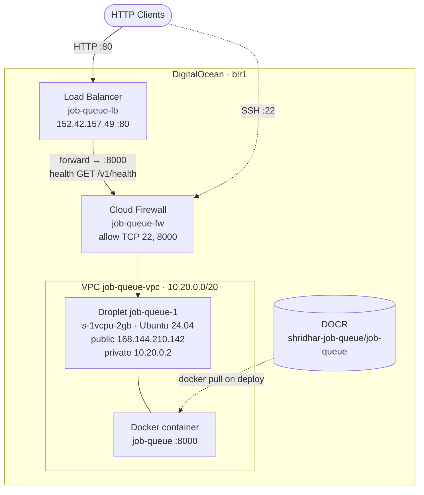
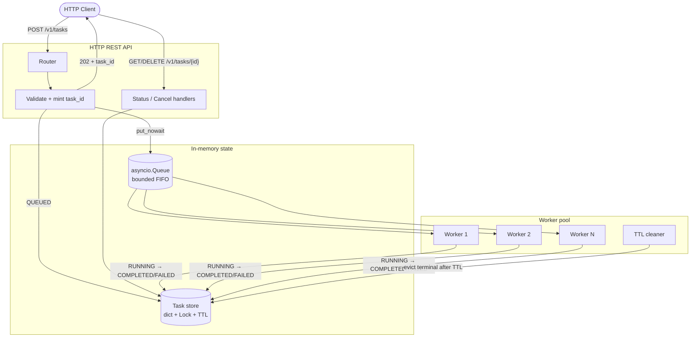
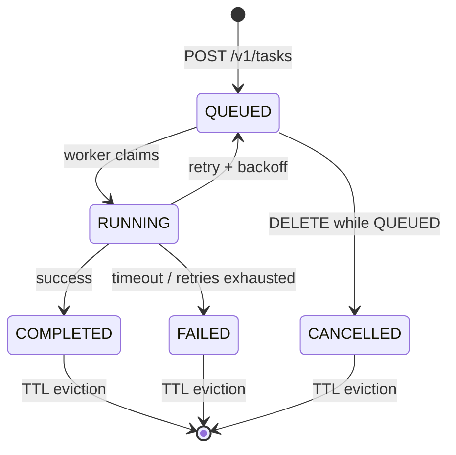

# Design (as deployed today)

In-memory async job queue: **one process, one container, one Droplet**. FastAPI + bounded `asyncio.Queue` + worker pool. Public entry is the DigitalOcean load balancer.

---

## Topology

| Resource | Value |
| :--- | :--- |
| Region | `blr1` |
| VPC | `job-queue-vpc` (`10.20.0.0/20`) |
| Droplet | `job-queue-1` — `168.144.210.142` / `10.20.0.2` |
| Firewall | `job-queue-fw` — TCP 22, 8000 |
| Load balancer | `job-queue-lb` — `152.42.157.49:80` → `:8000` |
| Image | `registry.digitalocean.com/shridhar-job-queue/job-queue:release-v0.1.0` |
| Host path | `/opt/job-queue` (Compose) |
| App port | `8000` |

Path: **Client → LB :80 → Firewall → Droplet :8000 → container**. Single replica only (queue/store are in-process memory).

---

## Application design

### Task lifecycle

### Runtime defaults (Compose)

| Setting | Default |
| :--- | :--- |
| `QUEUE_CAPACITY` | `10000` |
| `NUM_WORKERS` | `16` |
| `RETENTION_TTL_SECONDS` | `3600` |
| `CLEANER_INTERVAL_SECONDS` | `60` |
| `DRAIN_TIMEOUT_SECONDS` | `30` |
| `stop_grace_period` | `40s` |

### API surface

| Method | Path | Notes |
| :--- | :--- | :--- |
| `POST` | `/v1/tasks` | `202` enqueue; `429` when queue full |
| `GET` | `/v1/tasks/{id}` | Status / result |
| `DELETE` | `/v1/tasks/{id}` | Cancel if still `QUEUED` (`409` otherwise) |
| `GET` | `/v1/health` | LB health + queue metrics |
